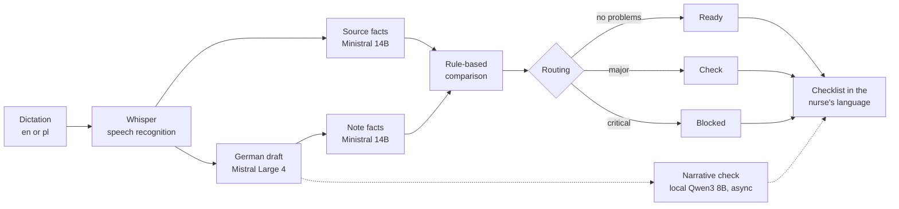

# CareLingo

CareLingo turns a nurse's dictation in English or Polish into a German care note, checks that
the note kept the dictated facts, and shows the nurse a checklist in their own language.

A nurse who dictates in their first language still has to sign a German note they may not
fully read. CareLingo tests one way to close that gap: extract typed facts from both texts,
compare them with rules, and give the result back in the language the nurse spoke.

> **Prototype.** This is an independent engineering project. It is not affiliated with,
> sponsored by or integrated with dexter health or any care provider. It uses synthetic data
> only, has not been clinically validated, is not a medical device, and must not be used for
> real care documentation.

## How it works



- **Facts, not similarity.** Doses, negations, sides, statuses and residents become typed
  fields and are compared by deterministic rules, so every flag can be traced to a difference.
- **A second check for what facts can't hold.** A local model from a different family lists
  statements the dictation doesn't support, such as a blanket "no other findings".
- **The checklist uses no model.** It is built from templates and a term table, so it can't
  add a translation error of its own. It can still repeat an extraction error.
- **A failed check is never a clean result.** If extraction fails, the note is blocked.

## Results

Held-out test split, 48 synthetic dictations, 95% Wilson intervals. The
[full report](docs/report.md) has the method, tables and error analysis.

| Measure | Result |
|---|---|
| Notes with a clinical error, typed dictation | 0/48 (CI 0–7%) |
| Correct notes flagged anyway | 14/48 (29%; English 21%, Polish 38%) |
| Real errors caught in a smaller model's drafts | 18/23 with facts, 22/23 with narrative check |
| Injected fact errors flagged | 324/324 (upper bound: injected errors are clean) |
| Cost per note, latency p50 / p95 | $0.0020, 10.8 s / 39.3 s |
| **Notes with a clinical error, from synthetic speech** | **20/48 (42%, CI 29–56%)** |
| **Of those, marked ready with nothing flagged** | **6/20 (30%, CI 15–52%)** |

The last two rows matter most. The verifier compares the note with what was *heard*, so it is
not a safeguard against speech recognition errors. If the nurse says 3 cm and recognition hears
30 cm, the note matches the transcript and passes. Only the nurse reading the checklist can
catch that.

## Quick start

You need [uv](https://docs.astral.sh/uv/) and Python 3.12. The demo needs no API key or GPU.

```bash
uv sync
```

```bash
uv run carelingo demo
```

The demo replays five recorded held-out notes, including ones the system gets wrong. Replay one
by name: `clean`, `caught`, `narrative`, `false-alarm` or `missed`.

```bash
uv run carelingo demo missed
```

To run a new dictation live, set `MISTRAL_API_KEY` in your environment. Use made-up text only:
this sends the dictation to Mistral's API.

```bash
uv run carelingo demo --language en --text "Mrs Lorenz, room 41. Pulse 76. No pain today."
```

Run the checks:

```bash
uv run pytest
```

```bash
uv run ruff check .
```

The tests recompute the report's main numbers from [`results/`](results/README.md), so these
figures can be checked without an API key. The commands are in the
[report](docs/report.md#9-reproducing-the-numbers).

### Optional parts

| To run | You need |
|---|---|
| `carelingo pipeline`, `baseline`, `extract` | `MISTRAL_API_KEY` |
| `carelingo narrative` | Ollama with `qwen3:8b` |
| `carelingo asr` | `uv sync --group asr`, an NVIDIA GPU and ffmpeg |
| `carelingo synthesize` | `uv sync --group tts` and Piper voices in `models/piper` |

`uv run carelingo --help` lists every command.

## Repository layout

| Path | Contents |
|---|---|
| `src/carelingo/` | Pipeline, extraction, verification, routing, checklist, speech and CLI |
| `data/cases/` | Synthetic cases; the test split is pinned by hash |
| `data/annotations/` | Error labels for each evaluated run |
| `results/` | Recorded runs behind the report |
| `docs/report.md` | Benchmark report |
| `scripts/` | Preparation of the PriMock57 evaluation subset |

## Known limitations

- **No clinical review.** No nurse, clinician or native speaker reviewed the cases, labels,
  notes or checklist wording. Cases and labels were written by an LLM.
- **Speech errors get through.** See the results above. The checks most likely to help, against
  the resident list and medication plan, are not built yet.
- **Too many false alarms.** About 3 in 10 correct notes are flagged, and more for Polish.
- **Small test set.** 48 dictations. Even "0 of 48" allows a true error rate of up to 7%.
- **No real in-domain speech.** Synthetic speech is not evidence about accented dictation on a
  noisy ward.
- **Not production software.** There is no authentication, audit trail or EHR integration, and
  hosted model outputs are not reproducible between runs.

The [report](docs/report.md#7-limitations) has the full list.

## Data and licences

- PriMock57 (Babylon Health) and FLEURS (Google) are used under CC BY 4.0 for speech recognition
  tests. `results/` includes transcripts from both.
- The optional `tts` group installs Piper, which is GPL-3.0. One of the evaluated voices is
  CC BY-NC 4.0, so it is non-commercial only. Generated audio is not in this repository.

Attributions are in the [report](docs/report.md#data-and-model-attributions).
